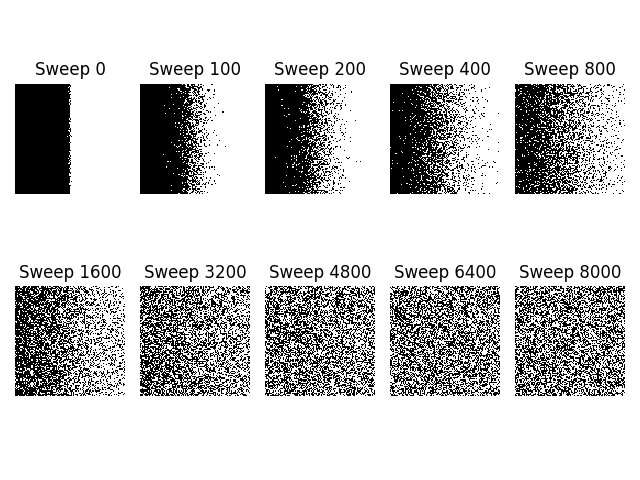
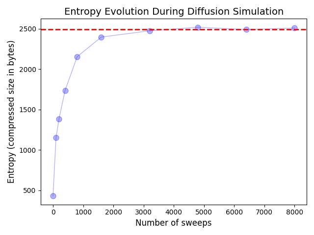

# Solutions for Cellular Automata

## Cellular Automata

| Paste Microscopic Snapshots Here  |
| :---- |

| Paste here labelled graph of Entropy vs Sweep Place a horizontal line where it is equilibrated.  |
| :---- |

## Sand (Extra Credit: 20 points) 

| Number of Pieces of Sand as a Function of Time   |
| :---- |

| Size of each avalanche as a function of Time   |
| :---- |

| Snapshot of Sand in Equilibrium   |
| :---- |

| Visualization of a Single Prototype Avalanche   |
| :---- |

| Plot and value of b   |
| :---- |

| Plot of sand starting in a large column   |
| :---- |

